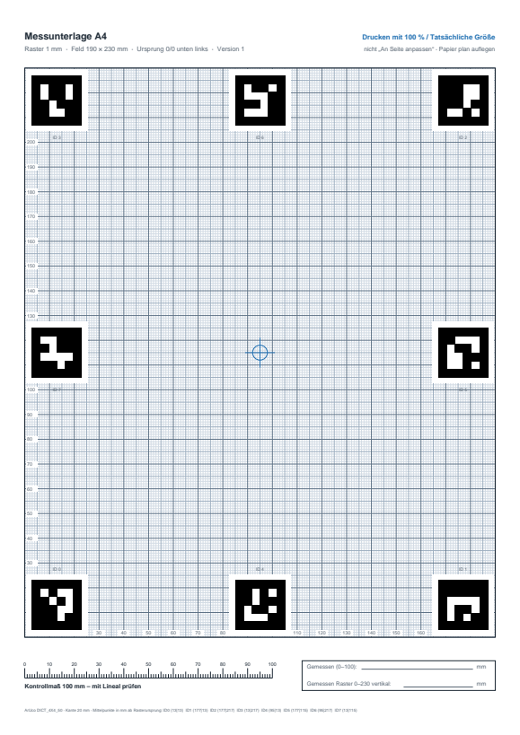
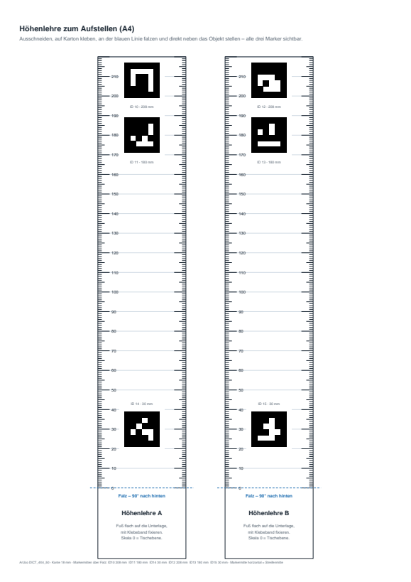
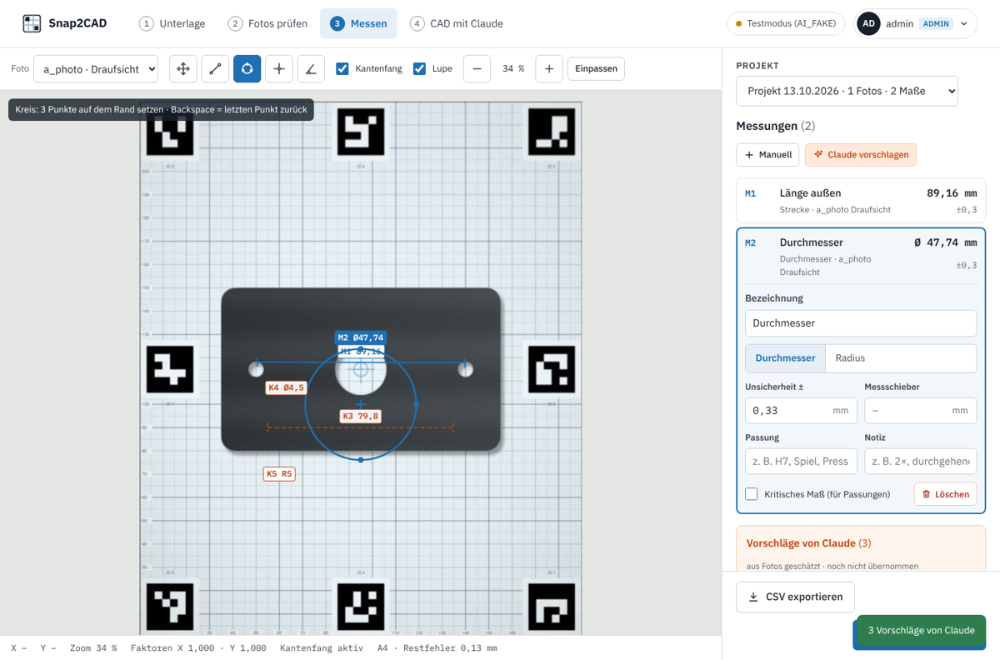
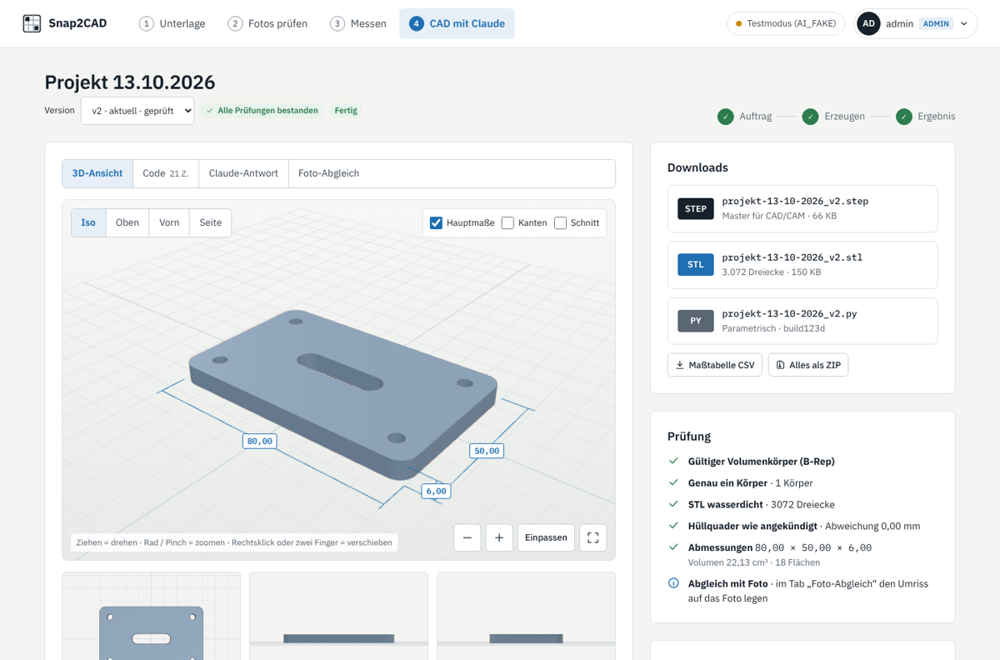

# Snap2CAD – Bauteile per Foto vermessen und als STEP/STL nachbauen

**Snap2CAD** besteht aus einer druckbaren Messunterlage mit mm-Raster und ArUco-Markern. Du legst ein Bauteil darauf, fotografierst es mit dem Handy, und eine KI (oder das mitgelieferte Skript) entzerrt das Foto auf die Tischebene und misst die Konturen in Millimetern. Ein fertiger Prompt – oder die mitgelieferte Web-App mit Claude – führt anschließend vom Messergebnis zum parametrischen CAD-Modell mit **STEP- und STL-Export** für 3D-Druck oder CNC-Fräsen.

> **English summary:** Snap2CAD is a printable measuring mat (A4/A3) with a 1 mm grid and ArUco markers. Photograph a part on it, and an AI with code execution (or the included script) rectifies the photo to true scale and measures it. A ready-made prompt – or the included self-hosted web app with Claude – then turns the measurements into a parametric CAD model exported as STEP and STL. The prompt and documentation are in German.

<p align="center">
  
  &nbsp;&nbsp;
  
</p>

## Inhalt

| Datei | Zweck |
|---|---|
| [`pdf/Messunterlage_A4.pdf`](pdf/Messunterlage_A4.pdf) | Messfeld 190 × 230 mm, Höhenlehre bis 220 mm, Anleitung |
| [`pdf/Messunterlage_A3.pdf`](pdf/Messunterlage_A3.pdf) | Messfeld 270 × 360 mm, Höhenlehre bis 340 mm, Anleitung |
| [`PROMPT.md`](PROMPT.md) | Prompt für KI-Sessions: Vermessung → Maßtabelle → CAD → STEP/STL |
| [`tools/check_photo.py`](tools/check_photo.py) | Prüft ein Foto (Marker, Restfehler) und erzeugt eine maßstäbliche Draufsicht |
| [`generator/make_mat.py`](generator/make_mat.py) | Erzeugt die PDFs neu, z. B. nach eigenen Anpassungen |
| [`docs/marker_layout.json`](docs/marker_layout.json) | Maschinenlesbare Markerpositionen für beide Formate |
| [`web/`](web/), [`Dockerfile`](Dockerfile), [`docker-compose.yml`](docker-compose.yml) | Web-App: Unterlage erzeugen, Fotos prüfen, im Browser messen, CAD mit Claude ([siehe unten](#web-app-docker)) |

Jedes PDF hat drei Seiten: Messunterlage, Höhenlehre zum Ausschneiden und eine Kurzanleitung.

## So funktioniert's

Die acht Marker sitzen an bekannten Positionen. Aus ihren Ecken im Foto wird eine Homographie berechnet, also die perspektivische Abbildung vom Foto auf die Tischebene. Damit lässt sich jedes Foto auf eine maßstabsgetreue Draufsicht zurückrechnen, auch wenn es leicht schräg aufgenommen wurde. Vier sichtbare Marker reichen, acht machen das Ergebnis robuster, falls das Bauteil einen Marker verdeckt.

## Schnellstart

1. **Drucken** mit *100 % / Tatsächliche Größe*. Nicht „An Seite anpassen“.
2. **Kontrollmaß prüfen**: Die 100-mm-Skala unten links mit einem Stahllineal nachmessen und den Wert ins Feld unten rechts schreiben. Steht er mit auf dem Foto, wird eine Abweichung des Druckers herausgerechnet.
3. **Unterlage plan fixieren** (Klebeband an den Ecken) und das Bauteil mittig auflegen. Alle Marker frei lassen.
4. **Fotografieren**: senkrecht von oben, 50–70 cm Abstand, mit 2×- oder 3×-Zoom statt Weitwinkel. Für Höhen das Teil kippen und erneut von oben fotografieren, oder die Höhenlehre direkt neben das Objekt stellen (alle drei Marker im Bild) und von der Seite fotografieren.
5. **Auswerten**: in der [Web-App](#web-app-docker), mit [`PROMPT.md`](PROMPT.md) in einer KI mit Code-Ausführung, oder selbst prüfen:

```bash
pip install -r requirements.txt
python tools/check_photo.py foto.jpg            # Format A4/A3 wird erkannt, sonst --size A4
```

Das Skript meldet die erkannten Marker und den Restfehler je Marker und speichert `foto_entzerrt.jpg` mit 10 px/mm. Ursprung ist die untere linke Rasterecke. In dieser Draufsicht entspricht jeder Pixelabstand direkt einem Maß in mm. Ist eine Höhenlehre im Bild, entsteht zusätzlich `foto_entzerrt_hoehenlehre.jpg` (x = Mitte des Streifens, y = Höhe über dem Tisch).

## Genauigkeit

| Situation | Erwartbar |
|---|---|
| Flache Teile, Kanten liegen auf der Unterlage auf | ca. ±0,5 mm |
| Restfehler der Entzerrung (`check_photo.py`) | ≤ 0,5 mm gut · ≤ 1 mm brauchbar · darüber Foto wiederholen |
| Kanten oberhalb der Tischebene | Parallaxe, siehe unten |

**Parallaxe:** Die Entzerrung gilt exakt nur für die Tischebene. Was höher liegt, ist näher an der Kamera und erscheint größer. Faustregel:

> Fehler ≈ Maß × Höhe über Tisch ÷ Kameraabstand

Beispiel: Eine 100 mm breite Oberkante in 50 mm Höhe, fotografiert aus 500 mm, wirkt etwa 10 mm zu breit. Deshalb an der Auflagekante messen, aus größerem Abstand mit Zoom fotografieren oder das Teil kippen.

**Passungen** (Lagersitze, Wellen, Gewinde, Anschlussmaße) mit dem Messschieber nachmessen. Fotos liefern Geometrie und Lage, keine Passmaßgenauigkeit.

Getestet wurde die Erkennung an gerasterten PDFs und an künstlich schräg verzerrten, unscharfen Aufnahmen: Alle Marker wurden erkannt, der Restfehler lag bei maximal 0,4 mm. Erfahrungswerte mit echten Handyfotos sind als Issue oder Pull Request willkommen.

## Der Prompt

[`PROMPT.md`](PROMPT.md) enthält die komplette Spezifikation der Unterlage, damit eine KI ohne weiteres Vorwissen korrekt rechnet. Der Ablauf hat zwei Stufen:

- **Teil A – Vermessung:** Marker erkennen, entzerren, messen, Maßtabelle mit Unsicherheiten. Danach stoppt die KI und lässt die Maße bestätigen.
- **Teil B – CAD:** parametrisches Modell mit [build123d](https://github.com/gumyr/build123d) (oder CadQuery), fertigungsgerechte Regeln für FDM bzw. CNC, Export als STEP und STL, Pflichtprüfung (STEP-Re-Import, wasserdichtes STL, Abgleich mit dem Foto).

Der Prompt setzt eine KI mit Python-Ausführung voraus. Ohne Code-Ausführung bleibt es bei Schätzwerten vom Raster.

## Spezifikation

- Marker: ArUco `DICT_4X4_50`, aufrecht gedruckt
- Koordinaten: mm, Ursprung untere linke Rasterecke, X nach rechts, Y nach oben

| Format | Raster | Markerkante | Marker-IDs |
|---|---|---|---|
| A4 | 190 × 230 mm | 20 mm | 0–7 |
| A3 | 270 × 360 mm | 25 mm | 0–7 |
| Höhenlehre | Streifen 45 mm breit, 0 = Falz | 18 mm | A: 10, 11, 14 · B: 12, 13, 15 |

Markermitten (X | Y in mm):

| ID | Position | A4 | A3 |
|---|---|---|---|
| 0 | unten links | 13 \| 13 | 15,5 \| 15,5 |
| 1 | unten rechts | 177 \| 13 | 254,5 \| 15,5 |
| 2 | oben rechts | 177 \| 217 | 254,5 \| 344,5 |
| 3 | oben links | 13 \| 217 | 15,5 \| 344,5 |
| 4 | unten Mitte | 95 \| 13 | 135 \| 15,5 |
| 5 | rechts Mitte | 177 \| 115 | 254,5 \| 180 |
| 6 | oben Mitte | 95 \| 217 | 135 \| 344,5 |
| 7 | links Mitte | 13 \| 115 | 15,5 \| 180 |

Höhenlehre, Markermitten über dem Falz (horizontal mittig): A4 – ID 10/12 auf 208 mm, ID 11/13 auf 180 mm, ID 14/15 auf 30 mm · A3 – ID 10/12 auf 328 mm, ID 11/13 auf 300 mm, ID 14/15 auf 30 mm.

Die Markerpositionen stehen zusätzlich klein unten auf jedem Blatt. Ein Foto ist damit auch ohne dieses Repo auswertbar.

## PDFs selbst erzeugen

```bash
pip install -r requirements.txt
python generator/make_mat.py pdf > docs/marker_layout.json
```

Formate, Markergröße, Farben und Texte stehen oben bzw. in den Funktionen `mat_page`, `strip_page` und `guide_page` des Skripts. Nach Änderungen an Markerpositionen auch `PROMPT.md` und diese README anpassen.

## Web-App (Docker)

Alles aus diesem Repo als selbst gehostete Web-Oberfläche: Unterlage als PDF erzeugen, Fotos hochladen und prüfen, im Browser messen und mit Claude ein CAD-Modell erzeugen lassen.

<p align="center">
  
  
</p>

| Schritt | Was passiert |
|---|---|
| 1 · Unterlage | PDF in A4 oder A3, Seiten wählbar, optionale Kopfzeile, Vorschau |
| 2 · Fotos prüfen | Marker-Erkennung, Restfehler je Marker, entzerrte Draufsicht und Höhenlehre, Kontrollmaß-Faktoren |
| 3 · Messen | Strecke, Kreis aus 3 Punkten, Punkt, Winkel, Höhe · Kantenfang, Lupe, Zoom · Messschieber-Werte, kritische Maße · Claude schlägt zusätzlich Maße aus dem Foto vor |
| 4 · CAD mit Claude | Claude schreibt build123d-Code, eine Sandbox erzeugt STEP und STL, prüft sie und lässt Fehler automatisch korrigieren · 3D-Ansicht (drehen, zoomen, Schnitt), Foto-Abgleich, Änderungswünsche als neue Versionen, Download als ZIP |

### Starten

```bash
git clone https://github.com/CallMeTechie/snap2cad.git && cd snap2cad
cp .env.example .env          # ANTHROPIC_API_KEY eintragen, Rest nach Bedarf
docker compose up -d --build
docker compose logs app       # beim ersten Start: Admin-Passwort (falls ADMIN_INITIAL_PASSWORD leer)
```

Danach unter `http://localhost:8000` als `admin` anmelden. Beim ersten Login muss das Passwort geändert werden. Weitere Nutzer kommen nur per Einladungslink dazu (Benutzermenü → Benutzerverwaltung). Ohne `ANTHROPIC_API_KEY` funktionieren Unterlage, Fotos und Messen, nur die KI-Funktionen sind aus.

Der Port ist standardmäßig nur auf `127.0.0.1` gebunden. Für den Zugriff von außen einen Reverse-Proxy mit HTTPS davorsetzen (Caddy, Traefik, nginx) und `PUBLIC_URL` setzen, damit Einladungslinks stimmen.

### Sicherheit

- **Konten:** Passwörter mit Argon2, mindestens 12 Zeichen, Prüfung gegen häufige Passwörter. Login-Sperre nach 5 Fehlversuchen für 15 Minuten. Sitzungen als HttpOnly-Cookie, CSRF-Schutz, strikte Content-Security-Policy. Einladungs- und Reset-Links sind einmalig und werden nur als Hash gespeichert. Protokoll aller sicherheitsrelevanten Ereignisse für Admins.
- **Kosten:** Der API-Schlüssel bleibt auf dem Server. Jeder Nutzer hat ein monatliches Kontingent an CAD-Läufen (`DEFAULT_QUOTA`, pro Nutzer änderbar).
- **Sandbox:** Von Claude erzeugter Code läuft nie im Web-Container, sondern im Dienst `sandbox`: ohne Netzwerk, ohne Datenbank und ohne API-Schlüssel, schreibgeschütztes Dateisystem, jeder Lauf unter einer eigenen Benutzerkennung, mit Zeit-, Speicher- und Prozesslimits, seccomp-Filter (kein Programmstart, keine Sockets) und Python-Audit-Hook.

### Daten

Alles liegt im Docker-Volume `data` (SQLite-Datenbank, Fotos, CAD-Versionen). Sicherung: `docker compose stop && docker run --rm -v snap2cad_data:/d -v "$PWD":/b alpine tar czf /b/backup.tgz -C /d . && docker compose start`

Die Fotos, Maße und Beschreibungen eines CAD-Auftrags werden an die Anthropic-API übertragen. Das steht auch in der Oberfläche direkt am Knopf.

### Entwicklung ohne Docker

```bash
pip install -r web/requirements.txt
cd web && npm ci && sh scripts/vendor.sh      # three.js und Schriften nach static/vendor
DATA_DIR=./data RUNS_DIR=./runs SANDBOX_MODE=local AI_FAKE=1 uvicorn app.main:app --reload
```

`SANDBOX_MODE=local` führt den CAD-Code ohne Container-Trennung aus (nur Limits, seccomp und Audit-Hook) und ist nur für die Entwicklung gedacht. `AI_FAKE=1` liefert feste Testantworten statt echter API-Aufrufe.

## Tipps aus der Praxis

- Mattes Papier verwenden. Glanz und Blitz überstrahlen Marker.
- Die Unterlage auf eine Glasplatte oder einen festen Karton kleben. Welliges Papier ist die häufigste Fehlerquelle.
- Fotos als Originaldatei weitergeben. Messenger komprimieren und verschlechtern die Kantenerkennung.
- Dunkle Teile auf heller Unterlage sind ideal. Bei hellen oder glänzenden Teilen hilft seitliches, diffuses Licht für deutliche Kanten.

## Lizenz

- Code (`core/`, `generator/`, `tools/`, `web/`): MIT
- PDFs, Prompt und Dokumentation: CC BY 4.0

## Mitmachen

Issues und Pull Requests sind willkommen, besonders Messberichte mit echten Fotos (Soll/Ist-Vergleich), weitere Formate (Letter, A5) und Erfahrungen mit verschiedenen KI-Werkzeugen.
